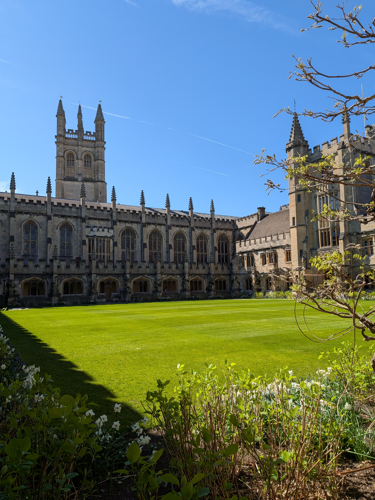

## About the series

> Visual ecology research seeks to understand how visual information is gathered and processed from the environment, in turn affecting animal behaviour or survival, and ultimately how this feeds back into ecological or evolutionary change.

> The Visual Ecology conference series organises UK-based annual conferences that attract international leaders in the field, while remaining accessible and welcoming to ECRs and PGRs. The series started as semi-regular CamoCon (camouflage-focused) conferences hosted by the University of Bristol, and the Anti-predator Colouration Symposia hosted by the University of Exeter over a number of years, followed by our joint take-over of ASAB’s 2025 Winter conference. Following this decade of ad-hoc meetings, the Visual Ecology conference series will now move between key labs in the UK every year, with Oxford in 2027, Swansea in 2028 and Bristol in 2029.

## Oxford 2027

| Organised by Christian Drerup: more info to come! |   |

> Link to the [keynote speakers]({{ '/keynote-speakers/' | relative_url }}),
> [venue]({{ '/venue/' | relative_url }}) and [registration]({{ '/register/' | relative_url }})
> pages as useful.

<!-- The hero (dates, register button, key dates) comes from _data/conference.yml, and the
     "Past conferences" and "Key groups" sections below this text from
     _data/past_conferences.yml and _data/groups.yml. -->
